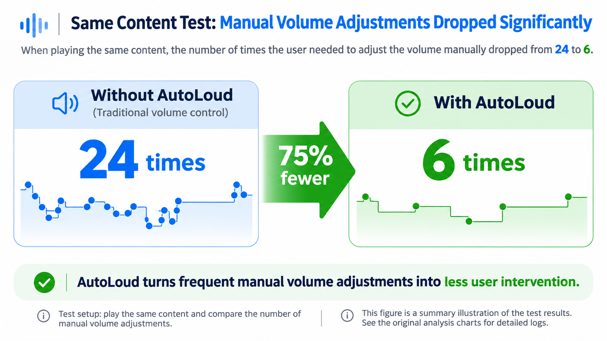

# Loudwell

### From constant volume adjustments to consistently comfortable listening.

*You adjust once. We handle the rest.*

[**English**](README.md) · [简体中文](README.zh.md) · [Latest release](https://github.com/SparrowReivun/Loudwell/releases) · [Report an issue](https://github.com/SparrowReivun/Loudwell/issues)

> Hello, my dear sound-obsessed friend. I have good news for you: state-of-the-art automatic mixing can finally serve not only professional audio producers, but also the rest of us who simply love music. Please let me introduce **Loudwell** — software you open and it just works. It already lets me focus 100% on the music, videos and games I play, and has taken away most of my daily volume adjustments.

## Why Loudwell?

Have you ever wondered how many times a day you need to adjust the volume?

Every time we switch between videos and music, or move from one scene to another in a game, we seem to be caught between dialogue that is too quiet and music that is too loud. And then there are those WeChat notifications loud enough for the whole office to hear.

For over a century, we have relied on volume controls, repeatedly turning the sound up and down. Most of the time, we have only one goal:

**To make the sound comfortable to listen to.**

So why can't we simply tell our devices how loud we like things, and let them take care of the rest?

That is the problem Loudwell sets out to solve.

You don't have to change your habits. Keep using the volume keys just as you always have. The difference is that this time, your adjustment does more than change the current volume: it also tells Loudwell what you prefer.

> **“This is how loud I like it.”**

Loudwell acts as your personal sound assistant: it continually learns and remembers your listening preferences, adapts to loudness differences across content, and adjusts the volume to help you stay immersed in what you are listening to.

*“Every volume adjustment teaches your device what you like.”*

---

## Download and installation

1. Download the latest `Loudwell-windows.zip` from [Releases](https://github.com/SparrowReivun/Loudwell/releases) (about 100 MB; no Python installation required).
2. Extract it anywhere and run `Loudwell.exe`. **Keep the whole extracted folder together** — do not move the `exe` on its own; the program needs the files next to it, and your settings and logs live in the same folder.
3. Before the first launch, connect your headphones or speakers and make sure they play sound normally.

### First launch: install VB-CABLE (recommended)

Loudwell's recommended **Real-time control** mode needs the VB-CABLE virtual audio driver, which ships unmodified inside the release. If it is not installed yet, Loudwell asks once on first launch:

1. Click **Install VB-CABLE…** and answer **Yes** to the Windows permission prompt.
   (Missed the prompt? Choosing **Real-time control** in the **Control mode** box at the top right of the dashboard brings it back; or run `_internal\vbcable\VBCABLE_Setup_x64.exe` from the extracted folder as administrator.)
2. In the VB-CABLE installer window, click **Install Driver**.
3. **Reboot**, then open Loudwell again — it takes effect by itself.

You can also choose **Later**: Loudwell then works in **Zero-delay control**. The two modes can be switched at any time at the top right of the dashboard, with immediate effect:

| Control mode | What you get |
| --- | --- |
| **Real-time control (recommended)** | Nothing gets past the ceiling, not even the first instant of a sound; boost is no longer limited by the system volume; adds about 50 ms of delay |
| **Zero-delay control** | No delay — for shooters, rhythm games and anything latency-sensitive; the first instant of a sudden sound gets through, and boost ends at full system volume |

A few things to know about real-time control:

- While Loudwell runs, the Windows default output device shows **CABLE Input**. That is expected; it is switched back to your device when Loudwell exits.
- To change the playback device, pick it in Loudwell's **Output device** box, or in the Windows sound menu as usual — Loudwell follows either way.
- If Loudwell ever exits abnormally and the PC is silent, open Loudwell again, or select your headphones or speakers in Windows sound settings.
- To uninstall VB-CABLE: run `_internal\vbcable\VBCABLE_Setup_x64.exe` as administrator, click Remove Driver, and reboot.

### Security notes

**Windows SmartScreen:** the first run may show "Windows protected your PC". Make sure the file came from this project's official Releases page, then continue via "More info → Run anyway".

**Antivirus false positives:** Loudwell is not code-signed yet (we are applying). Because it hooks the volume keys, captures system audio and controls per-application volume, heuristic engines such as Windows Defender may flag it. You can check the download on [VirusTotal](https://www.virustotal.com/), and download only from Loudwell's official GitHub page.

**Language:** Loudwell follows the Windows display language (Chinese or English); you can switch it manually on the last row of the Settings page.

## 1. Getting started

One of Loudwell's design goals is **zero additional learning curve**.

After launch, Loudwell takes over parts of the system volume-control logic without changing how you interact with it. You can still adjust the sound with a hardware volume knob, keyboard volume keys, or the sliders in the app.

Loudwell records your adjustments as **preference loudness P**, and gradually learns the loudness characteristics of different applications.

Over time, it adapts to:

- Loudness differences between music and videos;
- Quiet dialogue versus intense combat in games;
- The typical loudness of individual applications;
- Natural dynamic changes within content;
- Notification sounds that are difficult to adjust independently in some apps.

Most importantly, Loudwell **does not simply flatten every sound to the same level**.

Drawing on research in automatic music mixing, we aim to control overall loudness while respecting creators' intentions as much as possible: **quiet passages should stay quiet, and intense scenes should retain their impact**.

Loudwell also provides a **per-application mixer**, giving you independent control over each application's volume.

### The dashboard shows the two things you need

- **State** — in plain words, what Loudwell is doing: "Steady · leaving the volume alone", "Too loud · turning down", "Too quiet · turning up", and in red "Too loud · protection triggered".
- **Preferred volume P** — a 0–100% slider; this is your volume knob. The volume keys and knob move it too.

Everything else (momentary / integrated loudness, source loudness, platforms…) is folded under **Details** until you want to tune.

### Shadow, the desktop dog

Loudwell comes with a desktop dog, modelled on the author's own dog Shadow. He sits quietly in a corner of the screen and speaks only when the state changes:

- Adjusted to the sound you like best
- It is a bit loud — turning it down for you
- It is a bit quiet — turning it up for you
- Too loud! Handling it right now

He dozes when nothing is playing. Drag him anywhere, double-click to open Loudwell, right-click to send him home; the Settings page can call him back or put him away at any time.

## 2. Background

### 2.1 The problems we set out to solve

People who have studied audio equipment are used to this idea:

> What we finally hear = source loudness + computer volume + external device volume.

But many ordinary people, who have never looked into their devices, understand volume like this: **I set the volume to 40%, so every sound should be 40%.**

I can already see some of you smiling at such a naive idea. Today I want to say: we can make that naive idea come true.

First, let us look at what is actually wrong with volume control today.

**1. Volume control is tedious, inconsistent and unintuitive — and the level you just set will most likely stop being right as soon as the content changes.**

**2. Most applications do not let you set separate volumes for media, ringtones and calls, and many contain absurdly extreme dynamic ranges.** In WeChat or WhatsApp, for example, the source loudness of a call may be around 1–10 while a message notification is 100. So there is never one volume at which the call is intelligible and the notification does not disturb everyone around you.

**3. How loud we want things varies enormously with the situation and with our mood.** In one of our tests — same day, same ambient noise, same headphones, same music — listeners who were moved by the music, with goosebumps all over, raised the gain by 7–11 dB compared with when they were not. That is a huge number, beyond what most volume-control systems are built to accommodate.

**4. Precisely because volume control is this hard to use, turning the sound on and silent mode off is, for most people, an anxious, nerve-racking, highly uncertain thing to do.** Most of the people we interviewed worry about a deafening notification suddenly going off, about the volume jumping when the content changes, or about an advert cutting in.

So in offices and other shared spaces, most people put up with the discomfort of wearing headphones for hours. They also get used to silent and vibrate modes, even though that sometimes means missing an important message. And those who really cannot afford to miss messages often pay extra for a smartwatch to remind them.

In short: to play sound out loud without worrying about disturbing others, you would have to walk through layer after layer of settings — system ringtone, media and alarm volumes, then each application's own — every time your surroundings or your mood change.

Is there another way out, besides layer upon layer of volume settings? There is.

### 2.2 Attempts to improve volume control

People have been trying to control playback volume for more than a century. As early as 1902, a gramophone patent described a mechanism for changing the volume of sound it produced [1].

More and more industries and companies now recognize the importance of reducing loudness differences and improving listening comfort.

Broadcasting, cinema, and streaming have gradually adopted loudness standards such as ITU-R BS.1770 and EBU R 128 [2][3]. Apple Music, YouTube, and Spotify also offer different forms of loudness normalization to reduce discrepancies between tracks or videos [4][5][6].

Yet these solutions cannot cover every listening situation. For example:

- **Differences between applications.** While listening to music at a comfortable volume, a WeChat notification may suddenly be much louder, and the application may not offer a convenient independent notification-volume setting.
- **Excessive dynamics within a work.** In some games, including *Zenless Zone Zero*, players may find dialogue too quiet but combat effects overwhelming. Similar problems can occur with videos or music.
- **Switching between apps and content.** Moving among music, videos, games, and other apps can still require frequent manual adjustments.

These issues rely heavily on users correcting them themselves. Delayed adjustments can interrupt activities, cause discomfort, and, at sufficiently high sound levels, may pose hearing risks [7].

### 2.3 Why not make every sound equally loud?

Some applications and audio plugins already address related problems using compressors or automatic gain control, such as Waves Vocal Rider [8].

In early versions of Loudwell, we explored a similar approach: keeping loudness inside a fixed range chosen by the user.

Testing quickly revealed its limitations.

**Dynamics are part of the artistic expression.**

Music needs both calm passages and climaxes. Films need quiet dialogue as well as dramatic scenes. Games use changes in loudness to create immersion.

If every sound is forced into a narrow loudness interval, the system has to change gain frequently. This can damage the dynamics that the creator intended and make listening feel unnatural.

The real challenge is therefore not simply to make everything equally loud, but rather:

> **How can we preserve a work's intended dynamics while keeping different content as comfortable to listen to as possible?**

I explored several different designs, spent more than 200 hours developing, testing, and iterating on them, and eventually arrived at Loudwell's current core approach.

It learns from your own adjustments and aims to solve everyday volume problems in one place.

#### What really has to be told apart: loudness differences and loudness anomalies

A difference in loudness is not necessarily a problem; only loudness that violates the listener's sense of comfort needs intervention. For example:

- Music moving from a quiet passage to a climax is a legitimate change in loudness.
- Speech that stays hard to hear after switching to a meeting app probably needs more gain overall.
- A new notification that briefly reaches an extreme level, or a loud advert cutting into playback, needs fast protection — even when it comes from the same application.

So Loudwell cannot simply aim for the loudness to equal P at every moment. It has to pursue three things at once:

> **Listener comfort + preserved dynamics + protection against abnormal loudness**

P is not a level every time window must hit; it is the anchor of the listener's long-term sense of comfort.

*You adjust once. We handle the rest.*

## 3. How it works (overview)

Loudwell is built around one idea: **your volume adjustment is a statement of preference, not just a one-off command.**

- **You set the level you like.** Loudwell remembers it as your preferred loudness.
- **It keeps playback near that level.** Different apps and different content are brought towards the loudness you chose, without you touching the volume again.
- **It preserves dynamics.** Quiet passages stay quieter than loud ones; Loudwell does not flatten everything to one level.
- **It stays out of the way.** Brief, natural changes are left alone. Loudwell steps in only when the sound stays too loud or too quiet, and it turns down faster than it turns up.
- **It protects you from sudden loud sounds.** Notifications, adverts and other bursts are pulled down quickly; in Real-time control they are limited before they reach your ears.
- **Notifications are handled separately** from what you are listening to, so a message alert does not disturb your music level.

The underlying methods are part of ongoing research at QMUL C4DM. Technical details will be published in due course; for research or licensing enquiries, please contact us (see below).

## 4. Testing and real-world experience

Over the past few weeks, I have spent more than **200 hours** developing, testing, and refining different approaches to volume control.

Along the way, I abandoned ideas that looked promising but sounded unnatural in practice. I eventually arrived at two versions I am relatively happy with, and tested them for dozens of hours across music, video, and gaming.

**The change that makes me happiest is that I no longer need to keep reaching for the volume controls.**

In the past, I might adjust the volume hundreds of times over several hours at my computer. With Loudwell, in the scenarios I have tested so far, I can often set it once at startup and continue for hours with almost no further manual intervention.

That is what I wanted Loudwell to achieve:

**Less time adjusting the volume. More time enjoying the sound.**

In addition, in a small comparison test playing the **same content**, we recorded a drop in the number of manual volume adjustments from **24 to 6 — a 75% reduction**.

*Figure: Manual adjustments recorded in one small comparison test with the same content. 24 → 6, a 75% decrease. The result applies only to this test.*

So far, the evidence comes primarily from my own use and small-scale testing. I hope to validate and improve the approach with feedback from a wider range of users.

## 5. Known limitations and future plans

Loudwell is still under active development and testing, with plenty of room to improve.

### 5.1 New applications need a short learning period

When you use a new application for the first time, Loudwell does not yet know its loudness characteristics, so an initial manual adjustment may still be necessary.

After a short period of playback, control typically improves over time.

### 5.2 Better handling of highly dynamic music

With works that have a wide dynamic range, such as classical symphonic music, the current version can sometimes over-adjust and interfere with intended dynamics.

Preserving these dynamics more faithfully is one of our next priorities.

Test reference: [Classical symphonic music example](https://www.bilibili.com/video/BV1Vg3uzoEK5?t=8.2).

### 5.3 Audio-device switching issues

Frequent output-device changes, especially involving Bluetooth headphones, can sometimes prevent Loudwell from detecting the active device promptly. This may relate to Windows audio-device APIs and device-state updates.

Try selecting the Bluetooth device in Windows first and refreshing Loudwell's device list; if that fails, restart the program.

### 5.4 Latency and the audio path of real-time control

**Real-time control** already limits the sound before it is output, but it adds about 50 ms of delay, which is unfriendly to rhythm and competitive games — hence **Zero-delay control** remains.

In our tests the audio path is stable enough, but an occasional click is still possible under very heavy system load. We are working to reduce both latency and resource use.

Real-time control also depends on the third-party VB-CABLE driver, whose installation needs administrator rights and a reboot. We are evaluating options that do not rely on a third-party driver.

### 5.5 Supporting more operating systems

Loudwell is currently available **only for Windows**.

We are open to future macOS and Linux support and welcome discussions and collaboration with interested developers and researchers.

Contact:

- [jinjie.shi@qmul.ac.uk](mailto:jinjie.shi@qmul.ac.uk)
- [joshua.reiss@qmul.ac.uk](mailto:joshua.reiss@qmul.ac.uk)

## 6. Usage tips and feedback

If Loudwell is useful in your daily routine, consider enabling **“Start Loudwell with Windows”** on the overview page, so you don't have to launch it manually each time.

Loudwell continues to evolve. We welcome reports about the experience, especially audio situations that it still handles poorly.

Whether it is a song, a game, a video, or an annoying notification, your feedback may reveal new problems and help improve the system.

Feel free to [email us](mailto:jinjie.shi@qmul.ac.uk) or open an issue on [GitHub Issues](https://github.com/SparrowReivun/Loudwell/issues).

## Final thoughts

As someone who is often moved by music, and as a researcher in automatic mixing, I have long hoped that advances in the field could benefit not only professional audio production, but also everyone's everyday listening experience.

We have increasingly powerful audio-processing technology, yet something as fundamental as volume control still requires so much manual attention.

I hope Loudwell can be one step toward changing that.

Let's focus on what really matters: **enjoying music, films, and games.**

**Loudwell — Stop adjusting. Start listening.**

---

## References

[1] Berliner, E. (1902). *Gramophone*. U.S. Patent No. 692,502. [Library of Congress](https://www.loc.gov/resource/berl.11010127/).

[2] International Telecommunication Union. *Recommendation ITU-R BS.1770: Algorithms to Measure Audio Programme Loudness and True-Peak Audio Level*. [ITU](https://www.itu.int/rec/R-REC-BS.1770/en).

[3] European Broadcasting Union. *EBU R 128: Loudness Normalisation and Permitted Maximum Level of Audio Signals*. [EBU](https://tech.ebu.ch/publications/r128).

[4] Apple Support. *Use Sound Check in Apple Music*. [Apple](https://support.apple.com/en-us/109331).

[5] YouTube Help. *Control video volume — Stable volume*. [YouTube](https://support.google.com/youtube/answer/14106294).

[6] Spotify for Artists. *Loudness normalization on Spotify*. [Spotify](https://support.spotify.com/us/artists/article/loudness-normalization/).

[7] World Health Organization. *Deafness and hearing loss: Safe listening*. [WHO](https://www.who.int/news-room/questions-and-answers/item/deafness-and-hearing-loss-safe-listening).

[8] Waves Audio. *Riding Vocals with Vocal Rider*. [Waves](https://www.waves.com/riding-vocals-with-vocal-rider).

## About VB-CABLE

**Real-time control** uses the [VB-CABLE](https://vb-audio.com/Cable/) virtual audio driver; its driver pack ships unmodified inside the release.

VB-CABLE is a donationware by VB-Audio. It is not part of Loudwell and is not covered by this repository's licence. All participations are welcome at [www.vb-cable.com](https://www.vb-cable.com); for deployment in companies and institutions, please purchase the appropriate number of licences as described in [VB-Audio's licensing terms](https://vb-audio.com/Services/licensing.htm).

## License

Loudwell is provided free of charge for personal, non-commercial use. It is distributed in binary form only; the source code is not public. All rights reserved. Redistribution, commercial use, and licensing enquiries: please contact [jinjie.shi@qmul.ac.uk](mailto:jinjie.shi@qmul.ac.uk).

Loudwell builds on automatic-mixing research at QMUL C4DM (Centre for Digital Music).
